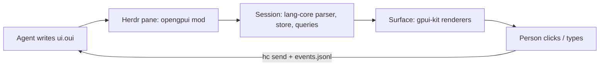

# openGPUI

[OpenUI Lang](https://openui.com) rendered with native [gpui-kit](https://gpui-kit.com)
elements, plus a [Herdr](https://herdr.dev) mod that lets coding agents show
people real UI (forms, tables, cards, approve/reject buttons) and get their
answers back.

OpenUI ships React (and Vue, Svelte, Angular) renderers. openGPUI is the gpui
one: the language, parser, `$state`, queries and actions are OpenUI's own
`@openuidev/lang-core`; the component library (names, zod schemas, prompts) is
OpenUI's own `genui-lib`, compiled without React. Only the drawing is new.



## Layout

| Path | What |
|---|---|
| `src/runtime/` | `Session`: one response's parse, `$state` store, queries/mutations, forms, validation, actions, errors. Framework-free port of react-lang's state hook. |
| `src/render/` | `Surface`: draws a session with gpui-kit as retained nested views (the root, each costly or stateful component, each overlay) and redraws only the views a change touches (`invalidate.ts`); owns the pump task that creates them and the retained native state (inputs, timers) outside `render`. `Tokens`: OpenUI's own design tokens, compiled from the pinned theme and resolved to gpui values. `fonts.ts`: the Inter cuts and how a stack resolves to them. `icons.ts`/`lucide.ts`: upstream's lucide lookup and the SVG layout a host ships. |
| `src/markdown/` | Markdown as react-ui draws it: react-markdown's own pipeline (unified, remark, the plugins each renderer passes) into an HTML tree, drawn with react-ui's markdown styles; code blocks highlighted by the same Prism grammars and themes. |
| `src/components/` | One renderer per OpenUI component. Missing ones draw a "not supported yet" box and are left out of prompts. `charts/` holds the chart renderers and their shared foundation (its `index.ts` documents the API). |
| `src/library.ts` | OpenUI's `openui` and `chat` libraries, and `subsetLibrary()` to prompt only what is implemented. |
| `herdr/` | The Herdr mod (`herdr/src/main.ts` → `herdr/mods/opengpui/main.js`); `theme.ts` maps the Herdr theme onto OpenUI's color tokens. |
| `harness/` | The headless harness's script (`harness/src/main.ts` → `harness/app/main.js`): the mod's content area without Herdr, for `scripts/shot.ts`. |
| `tools/` | `oui-harness` (Rust): runs the harness script offscreen on Herdr's gpui-shell. `oui-poke` (Swift): input for a Herdr preview window. |
| `bin/opengpui.ts` | The agent CLI: `prompt`, `check`, `show`, `wait`, `events`. |
| `skills/opengpui/` | Agent skill: how an agent uses the CLI and the pane. |
| `scripts/` | Upstream sync, assets (Inter cuts, lucide SVGs), build (Bun plugin that compiles upstream without React), install. |

## Develop

Needs [Bun](https://bun.sh), [uv](https://docs.astral.sh/uv/) (`uvx` runs fontTools to cut
the fonts), for the mod herdr-app, and for shots a Rust toolchain (`cargo`) on macOS.

```sh
bun install
bun run sync           # pinned OpenUI checkout, Inter and lucide assets (upstream.json); gpui/herdr types from Herdr
bun run check          # typecheck, build, herdr-app check on the mod
bun run test           # build, then session/library/token tests against the built headless bundle
bun run install-herdr  # copy the mod into ~/.config/herdr-app/mods/opengpui, link `opengpui` into ~/.local/bin
```

`bun scripts/shot.ts file.oui... [--mode light,dark] [--library chat] [--width 1280]
[--height 820] [--steps steps.json] [--out dir] [--spec]` is how to look at UI: it builds
this checkout and draws each file offscreen, with the real core on the gpui-shell runtime
Herdr embeds, and writes `tmp/shots/<file>-<mode>.png` (2x) once the view has settled. No
window appears and nothing takes focus, so it runs beside the person's work and in
parallel (`--jobs`, default 4: 122 files in both modes, 244 shots, take about 30 s).
`--steps` runs input after the first shot: click, hover, press, move and release an id or
a point, drag, wheel (both axes), keys, typing, a window resize, simulated time, the
clipboard's text, and a new text for the file (framed without its end line, it streams, as
when an agent writes it); `{ "shot": "name" }` saves `<file>-<mode>-<name>.png` (the list
is in `scripts/shot.ts`). Each step runs until settled, or `"settle": ms` long to catch a
short state. Gpui-base's own animations draw their end state (reduced motion). The actions
the session sends and every error and runtime warning are printed. `--spec` writes the element
description and the ids a step can name. The drawing comes from `tools/oui-harness`, a
Rust host on GPUI's headless app context (simulated clock, Metal offscreen renderer)
pinned to the herdr-app tag of the installed Herdr; it refuses to run when Herdr's
`~/.config/herdr-app/gpui-kit.d.ts` says Herdr's runtime has moved (see its `Cargo.toml`).

`bun scripts/preview.ts file.oui... [--mode light|dark|light,dark] [--look openui|herdr]
[--wait ms] [--keep]` is for the Herdr integration only (props, the events file, `hc`
replies, `--look herdr`, the pane chrome): it installs this checkout as its own mod
(`opengpui-<folder>`) in a background Herdr window of the checkout's own, shows each file
in a new tab, saves a screenshot to `tmp/preview/` once the tab reports itself idle
(`opengpui/status/<name>.json`: nothing left to parse, highlight, load or draw) and stays
so for 300 ms (a build that reports nothing: once the window has stopped changing),
and closes the tab. Checkouts never wait for each other.

`bun scripts/poke.ts click|hover|drag|scroll|key|type …` gives that preview window
pointer and keyboard input (open it with `--keep`): a small macOS helper,
`tools/oui-poke` built into `~/Applications/OuiPoke.app`, posts events straight to the
preview window's process, so the person's pointer, focus and own Herdr window are
untouched; it refuses any process that isn't a preview window. It needs Accessibility
once (System Settings → Privacy & Security → Accessibility) and is signed with an
"Apple Development" identity (`OUI_POKE_IDENTITY`) so the grant survives rebuilds.
Clicks, drags (a Slider), the wheel, keys and typing reach gpui; hover is sent as a
drag event, because gpui takes plain mouse moves only from the real pointer.
Coordinates are window points (`--px` takes pixels of a `herdr-app shot`).

`bun scripts/reference.ts setup` checks out OpenUI at the pin into `.reference/`
(gitignored) with react-ui's dependencies from upstream's lockfile, a headless Chromium
and the pinned InterVariable. `bun scripts/reference.ts serve` serves a page that draws
a `.oui` file with upstream's own `Renderer`, library and `ThemeProvider`, styled as
OpenUI's docs set it up (Tailwind preflight, react-ui's stylesheet, Inter), on port
6106. `bun scripts/reference.ts shot <file.oui> --out <file.png> [--mode light|dark]
[--library openui|chat] [--width px]` saves upstream's render of the file at device
scale 2, framed like the Herdr body, for side-by-side comparison with
`scripts/shot.ts`, and prints a URL with the same render live.

Outputs (`dist/`):

- `opengpui.js`: the library for gpui-shell hosts (`gpui-kit` and `gpui-base` stay imports).
- `opengpui-headless.js`: libraries, prompts and `Session` without gpui, for Bun/Node.
- `opengpui-cli.js`: the CLI.

The mod also ships `fonts/` and `icons/` (copied from `.upstream/assets` at build):

- **Fonts:** OpenUI draws Inter as a variable font. Its `wght` axis is set per
  style, its optical size follows the font size, and text is tracked −1%. gpui
  applies no variable axes and has no letter spacing, so `scripts/assets.ts` cuts
  static Inter fonts. It makes one per (optical size, weight) pair OpenUI's
  typography uses (`INTER_CUTS`, and `INTER_ITALIC_CUTS` for `em` and blockquotes,
  in `src/render/fonts.ts`), bakes the tracking into the glyph advances, and
  subsets to Latin, Greek and Cyrillic. Herdr loads a mod's fonts at start and on
  a look change; `install-herdr` reloads the look when they change. gpui keeps
  the faces it first found for a family, so changed cuts of an installed font
  need a Herdr restart (the installer says so). A host without them keeps its
  own UI font.
- **Icons:** lucide SVGs at the version react-ui depends on. The tarballs are
  checked against upstream's lockfile and `upstream.json`. Names resolve
  through upstream's own lookup (fuzzy matching, category fallbacks), compiled
  from the pin. There is one SVG set per stroke width react-ui gives icons
  (`LUCIDE_STROKE_WIDTHS`).

Markdown dependencies are pinned to the versions upstream's lockfile resolves
(unified 11, remark-parse 11, remark-gfm 4, remark-math 6, remark-breaks 4,
remark-rehype 11, refractor 5, react-syntax-highlighter 16 for its two Prism
themes), so a markdown string parses to the tree react-ui renders.

### Updating OpenUI

`bun scripts/sync-upstream.ts --to main` moves the pin. The sync fails if the
pinned `lang-core` version differs from the `@openuidev/lang-core` dev
dependency used for types; bump that too, then run `bun run check` and the
tests. `bun scripts/assets.ts` then checks that `upstream.json` still pins the
lucide release react-ui depends on.

### Porting a component

Components are ports, not redesigns. Each one comes from three upstream
sources under `.upstream/openui/packages/react-ui/src/`:

| Layer | Upstream | Here |
|---|---|---|
| Contract: name, props, prompt text | `genui-lib/<Name>/schema.ts` + `defineComponent` | compiled as is, never rewritten |
| Behavior: validation, actions, state, defaults | `genui-lib/<Name>/index.tsx` | ported line by line |
| Look: sizes, spacing, colors, typography | `components/<X>/<X>.tsx` + `*.scss` | ported value by value through `Tokens` |

1. Read all three. `Tokens` keeps upstream's token names, so scss reads across
   directly: `cssUtils.$space-s` → `t.spaceS`, `$border-default` → `t.borderDefault`,
   `@include typography(body, small)` → `textStyle(el, typography(t, "body", "small"))`.
   A lucide icon is `ctx.icon("ChevronLeft", { size: 16 })`; an scss `stroke-width`
   other than 2 is `stroke`, listed in `LUCIDE_STROKE_WIDTHS`. A new type size and
   weight pair needs its cut in `INTER_CUTS`.
2. Write the `Component` in `src/components/`, register it in `src/components/index.ts`,
   and name the upstream files it was ported from in the file header.
3. Where gpui can't do what the scss does, keep the closest gpui form and add the
   difference to the file header and to the list below.
4. Retained native state (inputs, sliders) goes through `ctx.retained(...)`; work that
   needs a live phase through `ctx.after(...)` (the surface's pump runs it and redraws
   this component's view); actions through `ctx.trigger(...)` (the pump runs them). A
   render reads session state only through tracked accessors: `ctx.field`, `ctx.form`,
   `ctx.streaming`, `ctx.queryLoading`, `ctx.viewportHeight`, `ctx.image`, or
   `ctx.watch(() => …)` for anything else; never `ctx.session` directly (handlers and
   `ctx.after` work may). A view redraws when what it read changes, so an untracked read
   leaves it stale.
5. Give the component a view of its own (`view(...)` in `src/components/index.ts`,
   setting `Component.view`) when its render cost grows with its content or it owns
   state that redraws often (hover, measuring, typing, loads). Its render must then
   return one element or null, and its parent must place it without restyling or
   inspecting it. A component that restyles the nodes it renders directly (the card
   blocks) sets `inlineChildren`: those draw inside its view, what they hold in views as
   anywhere else. A costly piece that is not a node (a step's markdown) goes through
   `ctx.piece(part, input, draw)`; a page-level overlay through `ctx.overlay(part, draw)`.
6. `bun run check`, then compare `bun scripts/shot.ts file.oui --mode light,dark`
   with `bun scripts/reference.ts shot file.oui --mode light|dark`.

### Where gpui differs from the browser

- **Views and the per-call budget:** gpui-shell interrupts a JS call that runs about
  50 ms in `render` (a task may run a few hundred ms), and Herdr's QuickJS is slow. The
  limit is per call, and each costly or stateful component (markdown and code, charts,
  tables, tabs, accordions, steps, carousels, images, card blocks, lists, form controls),
  the response root and each overlay draws in a retained gpui view of its own, so a page
  of any size is many bounded calls, and a change redraws only the views it touches: a
  stream chunk the views whose evaluated node changed, a hover or a toggle its own view,
  typing the input and what shows its value. A view met for the first time is an empty
  placeholder until it is created: a new part of the page appears a frame per level of
  nesting later. An interrupted view shows gpui's error card in its place; the rest of
  the page goes on. Within a view: strings without markdown skip the parser; longer
  markdown is parsed in a task in pieces (the same tree as one parse) and shows as its
  plain source for the first frames; a block longer than 6,000 characters is drawn
  through gpui-kit's lazy `list`, which builds only what is on screen. A parse step or a
  lazy row that would still run too long (one huge list item, say, or a row over 12,000
  characters) is not attempted, and that text stays plain. Code up to 300 characters is
  highlighted where it is drawn; longer code by a task in steps of 1,000 characters, so
  it shows plain for a moment, and a step cuts multi-line tokens (block comments,
  template strings) at its edges.
- **Tasks and plain promises:** an async `cx` acts for whichever call is running, and
  the continuation of a plain JS promise runs inside whichever call drains QuickJS's job
  queue (another view's render or handler, or another mod's). A long-lived task awaits
  only host promises it starts itself (sleeps, fs, exec); the surface's pump and Herdr's
  writer loop poll a flag on a sleep for that reason.
- **Fonts:** optical sizes come in steps (14, 16, 18, 24, 28, 32) instead of
  following every size, and a size/weight pair without a cut takes the nearest
  cut. Heading large/xl track −0.1px upstream; here they get the −1% of all other text.
- **Shadows:** OpenUI's custom shadows map to gpui's presets (`shadow-m` → `shadow_sm`, …):
  gpui-shell exposes only presets, not gpui's `BoxShadow`.
- **Transitions:** gpui animates only opacity, size and position, so upstream's color
  transitions (hover fills, borders) switch at once. `cursor: not-allowed` isn't drawn.
- **Choice controls:** gpui-base's unstyled `Checkbox`, `Radio` and `Switch` carry
  focus, keyboard and disabled state; the indicators are drawn from upstream's sizes
  (the checkmark is a path without round caps). There is no focus ring and no
  `overflow-wrap: anywhere`: a word longer than its row isn't broken.
- **Overlays:** a page-level `position: fixed` portal (Modal, the gallery's modal) is
  a surface overlay that the host stacks over its own area: in Herdr the pane, not
  the whole window. Percent sizes (`90vw`, `85vh`) are of the pane. An overlay opened
  inside another stacks above it, and the keyboard goes to the topmost one and back
  when it closes. Hover styles under an overlay still react (gpui gives scripts no
  occluding hitbox). An overlay is a view of its own; a host mounts the views
  `surface.renderOverlays()` returns over its area after `renderContent()`; one that
  doesn't shows no modals.
- **Images:** gpui draws only local files, so the host turns a `src` into a cached
  file first (Herdr downloads with curl into `~/.config/herdr-app/opengpui/images/`,
  bounded to 256 MiB; local paths only under `$HOME`); an image is an empty box until
  then, and while a response streams a src loads only once it stops changing.
  `object-fit` is drawn from the intrinsic size read from the file header; a clipping
  box doesn't round its children, so cropped pictures keep square corners. No CSS
  filters: ImageBlock's backdrop isn't blurred. Broken images show their alt text
  without the browser's icon.
- **Markdown:** gpui has no inline text layout, so a paragraph is a wrapping row
  of words, one element per word in its own style. Such text can't be selected,
  and a word may wrap one space earlier than in a browser (the trailing space
  counts). An inline code chip doesn't break across lines. Images show their alt
  text (gpui loads only local files). Math stays TeX in a code block, as upstream
  shows it until KaTeX loads; KaTeX isn't ported. A task list's checkbox
  imitates the browser's native one. Code highlighting needs refractor's ~300
  grammars, which gpui-shell can't register at load: the first code block starts
  registering them in 40 ms slices of a task, and code shows unhighlighted until they
  are in (about 0.35 s in the headless harness). refractor's `reason` grammar can't be
  registered under gpui-shell's frozen `Object.prototype` and is skipped.
- **Long markdown and long code:** a long block is a scroll region as tall as the
  pane's content area, with its own scrollbar; a long CodeBlock's box is as tall as
  its code or the pane, whichever is less. The wheel scrolls the region and, at its
  top or bottom end, passes to the page; while the region is only partly on screen
  the wheel still scrolls the region (gpui gives both every wheel event, and the
  region can't tell where it is). A block over the threshold but shorter than the
  pane leaves the rest of its region empty. Rows of the list allow no handlers:
  links are native links for http(s) addresses only, and only the hovered word
  underlines; code blocks there have no copy button; a table draws equal columns
  until a hidden draw has measured it, and a long table measures its first 25 rows
  and estimates the rest from their text. A long fence or table is cut into groups
  of rows, each of which scrolls sideways on its own.
- **Tables:** column widths come from measuring each cell, so a new page is drawn
  once with equal columns before they settle. The sideways scroll is the
  table's own offset (gpui-kit cannot scroll a div from code): wheel, trackpad
  and shift-wheel move it, and there is no scrollbar, which matches upstream's
  hidden one.
- **EditableTable:** its own grid (upstream styles it apart from Table): column widths
  follow the browser's auto table layout over each column's declared width, measured
  in script, so a new table draws once at its declared widths before it settles; it
  scrolls sideways by its own offset. Number cells edit plain text (no
  `type="number"`), parsed on save as upstream. In an open select menu Enter picks the
  highlighted option (upstream loses the pick: React bubbles the Enter to the cell).
- **Tabs, Accordion, Carousel:** tab lists and carousels scroll by an offset they
  own (wheel, trackpad, chevrons/arrows), with no scrollbar, as upstream hides it.
  Tab triggers are gpui-base's native `Tab`, which hears no keys: no arrow-key roving.
  gpui can't rotate, so the accordion chevron flips instead of turning; only opening
  and closing slide. The carousel's edge fade (`mask-image`) isn't drawn and its
  narrow-window card width needs the window width, which render can't read. A chosen
  tab or open item survives its parent being hidden, where Radix would reset it.
- **Date pickers:** gpui-kit's `Popover` hosts the calendar: it also closes on Escape
  and doesn't flip above the field near the window's bottom; its scale/fade isn't
  animated. The month and year lists scroll by an offset they own. The grid takes
  one keyboard focus with a roving focused day (DayPicker's own key map) instead of
  focusable day buttons. Two deliberate deviations: range ends given as strings are
  read (upstream crashes on them), and re-picking the selected day clears what the
  field shows as well as its value (upstream keeps showing the first pick).
- **Select:** the menu opens below the trigger and never flips above it; its
  fade/scale and the chevron's turn aren't animated. The pointer row and the
  keyboard row are separate highlights (Radix moves focus to the row under the
  pointer), so both can show at once.
- **Slider:** thumbs, drag and keyboard are gpui-base's native `Slider`; the fill and
  dots follow a drag one frame late. `SliderState.new` with some nonzero `min`
  (500…10000) never returns and stops the pump, so the native slider runs on
  `0..max-min` with values shifted back and rounded to the step's decimals as Radix
  does, and it's only made once `max > min` and `step > 0` (props stream in one by
  one). The value inputs stay left aligned (gpui-base's Input ignores alignment).
- **Lists and sections:** no transforms, so ListItem's indicator doesn't scale on hover
  (the fills and colors change). A clickable ListItem takes Tab and shows its hover
  look while focused, but no keys, as upstream's `role="button"` div. SectionBlock's
  open chevron is lucide's ChevronDown (gpui can't rotate) and its trigger has no
  arrow-key roving. OptionCards' `@container` queries read the field's measured
  width, so a new response draws once in the wide layout; cards have no focus ring
  or transitions. EntityList's right-aligned text pushes each wrapped line right.
- **Charts:** gpui has no SVG and no text measurement. Geometry is painted with gpui
  paths, replayed from the same path data upstream emits (d3-shape and react-ui's own
  bar paths); axis text is placed elements with SVG baselines taken from Inter's
  metrics. Labels are measured by drawing them invisibly, so a string with characters
  no chart has met yet holds the plot back one frame. Hover followers glide on native
  springs tuned to upstream's presets (active dots in a straight line, not along the
  curve); there are no round line caps; RadarChart's hover reacts inside the series
  polygons only. Pie, Radial, SingleStackedBar and Scatter hit-test their geometry
  (gpui paths take no pointer events); the hovered wedge's `brightness` switches at
  once. Scatter draws each dot as two boxes up to 1000 visible dots and as two cached
  paths per dataset beyond that, so overlapping dots then show their rings over each
  other's fills. Stacked legends scroll by their own offset. The hover tooltip is a gpui
  layer that takes the pointer (upstream's has `pointer-events: none`), so it passes
  its pointer moves on to the chart under it; its numbers are grouped by a shim for
  `toLocaleString()`, which gpui-shell's engine answers without separators.
- **Card blocks:** carousels scroll by an offset the block owns, with no scrollbar and
  no edge fade; container queries read the block's measured width, so a block is drawn
  once in the wide layout before it settles. A clickable card's hover
  `scale(0.995)` and its 2px focus ring aren't drawn. Snippet labels and values end
  in "…" only as plain text (gpui ellipsizes one run of text) and have no truncation
  tooltip. Context and Visual card pictures keep square corners where the card is
  rounded and get no backdrop blur behind tags.

## Status

Every component of OpenUI's `openui` and `chat` libraries (86) is ported from
react-ui: Stack, Card, CardHeader, Tabs/TabItem, Accordion/AccordionItem,
Steps/StepsItem, Carousel, Separator, Modal; TextContent, MarkDownRenderer, Callout,
TextCallout, InlineHeader, CodeBlock, Image, ImageBlock, ImageGallery; Table/Col,
EditableTable; BarChart, LineChart, AreaChart, HorizontalBarChart, RadarChart,
Series, PieChart, RadialChart, SingleStackedBarChart, Slice, ScatterChart,
ScatterSeries, Point; Form, FormControl, Label, Input, TextArea, Select/SelectItem,
DatePicker, Slider, CheckBoxGroup/CheckBoxItem, RadioGroup/RadioItem,
SwitchGroup/SwitchItem, Chips/ChipItem, OptionCards/OptionCard; Button, Buttons,
IconButton; Tag, TagBlock, Icon, EntityList, ListBlock/ListItem; the Snippet,
Overview, Context, Visual and Composite card blocks with their items, Text,
BoldText, IconText, ImageText, ImageTextLarge, MetricIndicatorInline,
MetricIndicatorWithStrikethrough; and in the chat library FollowUpBlock/FollowUpItem
and SectionBlock/SectionItem. Built against herdr-app 0.1.13
(gpui-shell 0.7.1), OpenUI lang-core 1.1.0, Inter 4.1, lucide 0.562.0, and at
upstream's lockfile versions date-fns 4.4.0, react-day-picker 9.14.0, d3-scale
4.0.2 and d3-shape 3.2.0.

The Herdr pane draws with OpenUI's tokens in the Herdr theme's colors by default
(`look: "herdr"`); `look: "openui"` uses OpenUI's own light/dark theme. Both
draw text in the shipped Inter cuts.

## License

MIT. Parts port or compile [OpenUI](https://github.com/thesysdev/openui) (MIT,
Thesys Inc.); see `LICENSE` and `licenses/openui.txt`. The Herdr mod ships
modified cuts of [Inter](https://github.com/rsms/inter) (SIL OFL 1.1,
`licenses/inter.txt`) and [lucide](https://lucide.dev) icons (ISC,
`licenses/lucide.txt`); each license also travels in the mod's `fonts/` and
`icons/` folders.
