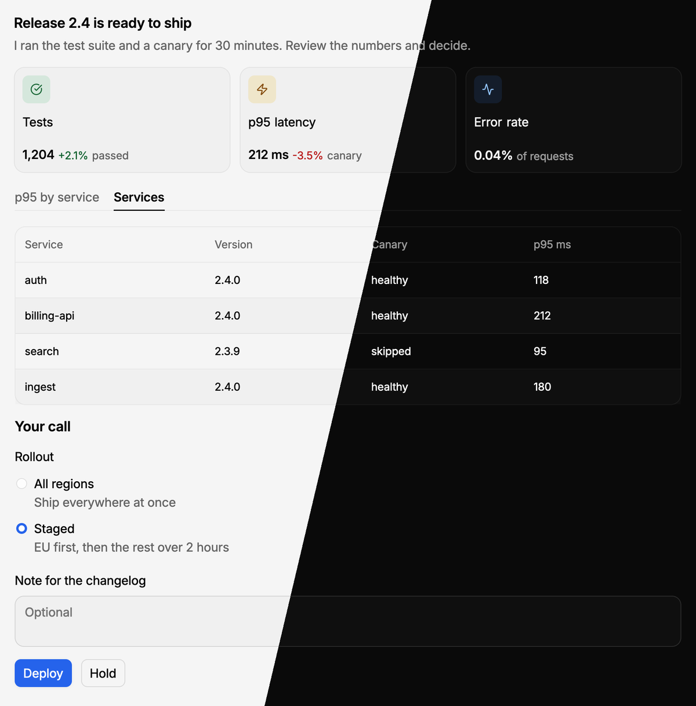
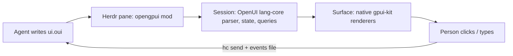

# openGPUI

Native UI for terminal coding agents. An agent writes a short [OpenUI Lang](https://openui.com)
file, and openGPUI draws it as a real interface in a [Herdr](https://herdr.dev) pane next to
the agent. The person reads tables and charts, fills in forms, clicks buttons, and the answer
goes back to the agent.



## Why

Terminal agents talk in text. That works until the agent needs a decision with context: a
release with numbers to review, a form with five fields, a choice between three plans. openGPUI
gives any agent that can run a shell command a way to show that as UI and wait for the answer.
It needs no browser and no web server, and the agent's own harness stays as it is.

## What you get

- **The whole OpenUI component library.** All 86 components of OpenUI's `openui` and `chat`
  libraries: layout, text and markdown, tables, charts, forms, buttons, cards. They are ported
  from `@openuidev/react-ui` to native [gpui-kit](https://gpui-kit.com) elements and look and
  behave like upstream.
- **Answers come back.** Button clicks arrive as JSON events, with the form's values, in the
  agent's terminal (`hc send`) or through `opengpui wait`.
- **Streaming.** The pane redraws as the agent writes the file and holds the inputs until it is
  complete.
- **Works with any agent.** A small CLI (`prompt`, `check`, `show`, `wait`, `events`, `close`)
  and a skill teach the agent the language and the loop. It was tried with Codex and omp.
- **Fits Herdr.** The pane draws in Herdr's theme colors, or in OpenUI's own light and dark
  look.

## Quick start

You need Herdr, [Bun](https://bun.sh) and [uv](https://docs.astral.sh/uv/).

```sh
git clone https://github.com/lukachi/openGPUI && cd openGPUI
bun install && bun run sync
bun run install-herdr      # installs the mod and links `opengpui` into ~/.local/bin
```

From a terminal inside Herdr:

```sh
cat > review.oui <<'EOF'
root = Stack([title, form])
title = CardHeader("Deploy 2.4?", "Canary is healthy for 30 minutes")
form = Form("deploy", Buttons([Button("Deploy", @ToAssistant("Deploy"), "primary"), Button("Hold", @ToAssistant("Hold"), "secondary")]), [note])
note = FormControl("Note", TextArea("note", "Optional", 2))
EOF
opengpui check review.oui   # ok: /…/review.oui
opengpui show review.oui    # opens the pane beside this terminal
opengpui wait review.oui    # blocks until the person clicks, then prints the event
```

```json
{"at":"…","src":"/…/review.oui","type":"continue_conversation","message":"Deploy","params":{},"formName":"deploy","formState":{"deploy":{"note":"ship it"}}}
```

To let an agent do this on its own, give it the skill: `opengpui skill` prints it
([`skills/opengpui/SKILL.md`](skills/opengpui/SKILL.md)), and `opengpui prompt` prints the
language manual.

## How it works



The language, parser, `$state`, queries and actions are OpenUI's own `@openuidev/lang-core`.
The component library (names, schemas, prompts) is OpenUI's own `genui-lib`, compiled without
React. Only the drawing is new.

## Documentation

- [Agent contract](docs/agent-contract.md): CLI commands, exit codes, events, the file format,
  tools. For skill authors and integrators.
- [Where gpui differs from the browser](docs/gpui-differences.md): what the native renderer
  can't match, per component.
- [Development](docs/development.md): building, the headless harness, the Herdr mod, porting a
  component.
- [Changelog](CHANGELOG.md).

## License and credits

MIT, see [`LICENSE`](LICENSE).

- [OpenUI](https://github.com/thesysdev/openui) (MIT, Thesys Inc.): openGPUI ports and compiles
  parts of it (`licenses/openui.txt`).
- [Inter](https://github.com/rsms/inter) (SIL OFL 1.1): the mod ships modified cuts
  (`licenses/inter.txt`).
- [lucide](https://lucide.dev) (ISC): icons (`licenses/lucide.txt`).
- [gpui-kit](https://gpui-kit.com) and [Herdr](https://herdr.dev): the native toolkit and the
  host.

The mod carries these licenses in its `licenses/` folder (Inter's in `fonts/`).
