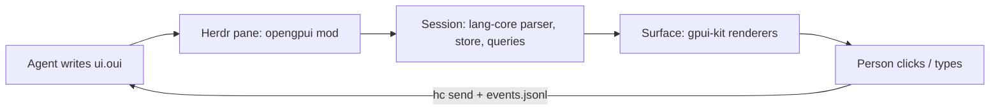

# openGPUI

[OpenUI Lang](https://openui.com) rendered with native [gpui-kit](https://gpui-kit.com)
elements, plus a [Herdr](https://herdr.dev) mod that lets coding agents show
people real UI (forms, tables, cards, approve/reject buttons) and get their
answers back.

OpenUI ships React (and Vue, Svelte, Angular) renderers. openGPUI is the gpui
one: the language, parser, `$state`, queries and actions are OpenUI's own
`@openuidev/lang-core`; the component library (names, zod schemas, prompts) is
OpenUI's own `genui-lib`, compiled without React. Only the drawing is new.



## Layout

| Path | What |
|---|---|
| `src/runtime/` | `Session`: one response's parse, `$state` store, queries/mutations, forms, validation, actions, errors. Framework-free port of react-lang's state hook. |
| `src/render/` | `Surface`: draws a session with gpui-kit; owns the pump task that creates retained native state (inputs, timers) outside `render`. `Tokens`: OpenUI's own design tokens, compiled from the pinned theme and resolved to gpui values. |
| `src/components/` | One renderer per OpenUI component. Missing ones draw a "not supported yet" box and are left out of prompts. |
| `src/library.ts` | OpenUI's `openui` and `chat` libraries, and `subsetLibrary()` to prompt only what is implemented. |
| `herdr/` | The Herdr mod (`herdr/src/main.ts` → `herdr/mods/opengpui/main.js`); `theme.ts` maps the Herdr theme onto OpenUI's color tokens. |
| `bin/opengpui.ts` | The agent CLI: `prompt`, `check`, `show`, `wait`, `events`. |
| `skills/opengpui/` | Agent skill: how an agent uses the CLI and the pane. |
| `scripts/` | Upstream sync, build (Bun plugin that compiles upstream without React), install. |

## Develop

Needs [Bun](https://bun.sh) and, for the mod, herdr-app.

```sh
bun install
bun run sync           # check out the pinned OpenUI commit (upstream.json); copy gpui/herdr types from Herdr
bun run check          # typecheck, build, herdr-app check on the mod
bun run test           # build, then session/library tests against the built headless bundle
bun run install-herdr  # copy the mod into ~/.config/herdr-app/mods/opengpui, link `opengpui` into ~/.local/bin
```

Outputs (`dist/`):

- `opengpui.js`: the library for gpui-shell hosts (`gpui-kit` and `gpui-base` stay imports).
- `opengpui-headless.js`: libraries, prompts and `Session` without gpui, for Bun/Node.
- `opengpui-cli.js`: the CLI.

### Updating OpenUI

`bun scripts/sync-upstream.ts --to main` moves the pin. The sync fails if the
pinned `lang-core` version differs from the `@openuidev/lang-core` dev
dependency used for types; bump that too, then run `bun run check` and the
tests.

### Porting a component

Components are ports, not redesigns. Each one comes from three upstream
sources under `.upstream/openui/packages/react-ui/src/`:

| Layer | Upstream | Here |
|---|---|---|
| Contract: name, props, prompt text | `genui-lib/<Name>/schema.ts` + `defineComponent` | compiled as is, never rewritten |
| Behavior: validation, actions, state, defaults | `genui-lib/<Name>/index.tsx` | ported line by line |
| Look: sizes, spacing, colors, typography | `components/<X>/<X>.tsx` + `*.scss` | ported value by value through `Tokens` |

1. Read all three. `Tokens` keeps upstream's token names, so scss reads across
   directly: `cssUtils.$space-s` → `t.spaceS`, `$border-default` → `t.borderDefault`,
   `@include typography(body, small)` → `textStyle(el, typography(t, "body", "small"))`.
2. Write the `Component` in `src/components/`, register it in `src/components/index.ts`,
   and name the upstream files it was ported from in the file header.
3. Where gpui can't do what the scss does, keep the closest gpui form and add the
   difference to the file header and to the list below.
4. Retained native state (inputs, sliders) goes through `ctx.retained(...)`;
   work that needs a live phase through `ctx.after(...)`.
5. `bun run check`, then compare it in Herdr with OpenUI's own theme:
   `opengpui show file.oui --look openui`.

### Where gpui differs from the browser

- **Fonts:** letter spacing and Inter's `wght` axis are not applied; the host's UI
  font is used rather than Inter, so weights like 560 land on the nearest the font has.
- **Shadows:** OpenUI's custom shadows map to gpui's presets (`shadow-m` → `shadow_sm`, …).
- **Markdown:** TextContent, MarkDownRenderer and Callout descriptions use gpui's
  `TextView`, with its own element styles, not upstream's markdown CSS. Text and
  BoldText lines are plain text rather than inline markdown.
- **Icons:** lucide icons (Tag icons, hint alert icon, table pager chevrons) are not
  drawn; the pager uses `‹ ›` glyphs.
- **Tables:** no table layout; columns share the width equally and cells truncate
  instead of scrolling the table sideways.
- **Callout auto-dismiss:** hides after 3 s without upstream's fade-out.

## Status

First wave, ported from react-ui: Stack, Card, CardHeader, TextContent,
MarkDownRenderer, Callout, Text, BoldText, Tag, Separator, Table/Col, Form,
FormControl, Label, Input, TextArea, Button, Buttons. The rest of OpenUI's ~80
components (tabs, selects, charts, modals, card blocks, …) are not drawn yet.
Built against herdr-app 0.1.13 (gpui-shell 0.7.1) and OpenUI lang-core 1.1.0.

The Herdr pane draws with OpenUI's tokens in the Herdr theme's colors by default
(`look: "herdr"`); `look: "openui"` uses OpenUI's own light/dark theme.

## License

MIT. Parts port or compile [OpenUI](https://github.com/thesysdev/openui) (MIT,
Thesys Inc.); see `LICENSE` and `licenses/openui.txt`.
