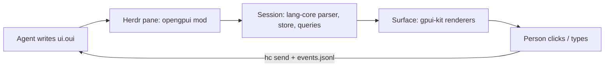

# openGPUI

[OpenUI Lang](https://openui.com) rendered with native [gpui-kit](https://gpui-kit.com)
elements, plus a [Herdr](https://herdr.dev) mod that lets coding agents show
people real UI (forms, tables, cards, approve/reject buttons) and get their
answers back.

OpenUI ships React (and Vue, Svelte, Angular) renderers. openGPUI is the gpui
one: the language, parser, `$state`, queries and actions are OpenUI's own
`@openuidev/lang-core`; the component library (names, zod schemas, prompts) is
OpenUI's own `genui-lib`, compiled without React. Only the drawing is new.



## Layout

| Path | What |
|---|---|
| `src/runtime/` | `Session`: one response's parse, `$state` store, queries/mutations, forms, validation, actions, errors. Framework-free port of react-lang's state hook. |
| `src/render/` | `Surface`: draws a session with gpui-kit; owns the pump task that creates retained native state (inputs, timers) outside `render`. `Tokens`: OpenUI's own design tokens, compiled from the pinned theme and resolved to gpui values. `fonts.ts`: the Inter cuts and how a stack resolves to them. `icons.ts`/`lucide.ts`: upstream's lucide lookup and the SVG layout a host ships. |
| `src/markdown/` | Markdown as react-ui draws it: react-markdown's own pipeline (unified, remark, the plugins each renderer passes) into an HTML tree, drawn with react-ui's markdown styles; code blocks highlighted by the same Prism grammars and themes. |
| `src/components/` | One renderer per OpenUI component. Missing ones draw a "not supported yet" box and are left out of prompts. |
| `src/library.ts` | OpenUI's `openui` and `chat` libraries, and `subsetLibrary()` to prompt only what is implemented. |
| `herdr/` | The Herdr mod (`herdr/src/main.ts` → `herdr/mods/opengpui/main.js`); `theme.ts` maps the Herdr theme onto OpenUI's color tokens. |
| `bin/opengpui.ts` | The agent CLI: `prompt`, `check`, `show`, `wait`, `events`. |
| `skills/opengpui/` | Agent skill: how an agent uses the CLI and the pane. |
| `scripts/` | Upstream sync, assets (Inter cuts, lucide SVGs), build (Bun plugin that compiles upstream without React), install. |

## Develop

Needs [Bun](https://bun.sh), [uv](https://docs.astral.sh/uv/) (`uvx` runs fontTools to cut
the fonts) and, for the mod, herdr-app.

```sh
bun install
bun run sync           # pinned OpenUI checkout, Inter and lucide assets (upstream.json); gpui/herdr types from Herdr
bun run check          # typecheck, build, herdr-app check on the mod
bun run test           # build, then session/library/token tests against the built headless bundle
bun run install-herdr  # copy the mod into ~/.config/herdr-app/mods/opengpui, link `opengpui` into ~/.local/bin
```

`bun scripts/preview.ts file.oui [--look openui|herdr] [--wait ms] [--keep]` builds
this checkout, installs it as its own mod (`opengpui-<folder>`), shows the file in a
new Herdr tab, saves a screenshot to `tmp/preview/` and closes the tab. A lock keeps
previews from several checkouts out of each other's way.

`bun scripts/reference.ts setup` checks out OpenUI at the pin into `.reference/`
(gitignored) with react-ui's dependencies from upstream's lockfile, a headless Chromium
and the pinned InterVariable. `bun scripts/reference.ts serve` serves a page that draws
a `.oui` file with upstream's own `Renderer`, library and `ThemeProvider`, styled as
OpenUI's docs set it up (Tailwind preflight, react-ui's stylesheet, Inter), on port
6106. `bun scripts/reference.ts shot <file.oui> --out <file.png> [--mode light|dark]
[--library openui|chat] [--width px]` saves upstream's render of the file at device
scale 2, framed like the Herdr body, for side-by-side comparison with
`scripts/preview.ts`, and prints a URL with the same render live.

Outputs (`dist/`):

- `opengpui.js`: the library for gpui-shell hosts (`gpui-kit` and `gpui-base` stay imports).
- `opengpui-headless.js`: libraries, prompts and `Session` without gpui, for Bun/Node.
- `opengpui-cli.js`: the CLI.

The mod also ships `fonts/` and `icons/` (copied from `.upstream/assets` at build):

- **Fonts:** OpenUI draws Inter as a variable font. Its `wght` axis is set per
  style, its optical size follows the font size, and text is tracked −1%. gpui
  applies no variable axes and has no letter spacing, so `scripts/assets.ts` cuts
  static Inter fonts. It makes one per (optical size, weight) pair OpenUI's
  typography uses (`INTER_CUTS`, and `INTER_ITALIC_CUTS` for `em` and blockquotes,
  in `src/render/fonts.ts`), bakes the tracking into the glyph advances, and
  subsets to Latin, Greek and Cyrillic. Herdr loads a mod's fonts at start and on
  a look change; `install-herdr` reloads the look when they change. gpui keeps
  the faces it first found for a family, so changed cuts of an installed font
  need a Herdr restart (the installer says so). A host without them keeps its
  own UI font.
- **Icons:** lucide SVGs at the version react-ui depends on. The tarballs are
  checked against upstream's lockfile and `upstream.json`. Names resolve
  through upstream's own lookup (fuzzy matching, category fallbacks), compiled
  from the pin. There is one SVG set per stroke width react-ui gives icons
  (`LUCIDE_STROKE_WIDTHS`).

Markdown dependencies are pinned to the versions upstream's lockfile resolves
(unified 11, remark-parse 11, remark-gfm 4, remark-math 6, remark-breaks 4,
remark-rehype 11, refractor 5, react-syntax-highlighter 16 for its two Prism
themes), so a markdown string parses to the tree react-ui renders.

### Updating OpenUI

`bun scripts/sync-upstream.ts --to main` moves the pin. The sync fails if the
pinned `lang-core` version differs from the `@openuidev/lang-core` dev
dependency used for types; bump that too, then run `bun run check` and the
tests. `bun scripts/assets.ts` then checks that `upstream.json` still pins the
lucide release react-ui depends on.

### Porting a component

Components are ports, not redesigns. Each one comes from three upstream
sources under `.upstream/openui/packages/react-ui/src/`:

| Layer | Upstream | Here |
|---|---|---|
| Contract: name, props, prompt text | `genui-lib/<Name>/schema.ts` + `defineComponent` | compiled as is, never rewritten |
| Behavior: validation, actions, state, defaults | `genui-lib/<Name>/index.tsx` | ported line by line |
| Look: sizes, spacing, colors, typography | `components/<X>/<X>.tsx` + `*.scss` | ported value by value through `Tokens` |

1. Read all three. `Tokens` keeps upstream's token names, so scss reads across
   directly: `cssUtils.$space-s` → `t.spaceS`, `$border-default` → `t.borderDefault`,
   `@include typography(body, small)` → `textStyle(el, typography(t, "body", "small"))`.
   A lucide icon is `ctx.icon("ChevronLeft", { size: 16 })`; an scss `stroke-width`
   other than 2 is `stroke`, listed in `LUCIDE_STROKE_WIDTHS`. A new type size and
   weight pair needs its cut in `INTER_CUTS`.
2. Write the `Component` in `src/components/`, register it in `src/components/index.ts`,
   and name the upstream files it was ported from in the file header.
3. Where gpui can't do what the scss does, keep the closest gpui form and add the
   difference to the file header and to the list below.
4. Retained native state (inputs, sliders) goes through `ctx.retained(...)`;
   work that needs a live phase through `ctx.after(...)`.
5. `bun run check`, then compare it in Herdr with OpenUI's own theme:
   `opengpui show file.oui --look openui`.

### Where gpui differs from the browser

- **Fonts:** optical sizes come in steps (14, 16, 18, 24, 28, 32) instead of
  following every size, and a size/weight pair without a cut takes the nearest
  cut. Heading large/xl track −0.1px upstream; here they get the −1% of all other text.
- **Shadows:** OpenUI's custom shadows map to gpui's presets (`shadow-m` → `shadow_sm`, …):
  gpui-shell exposes only presets, not gpui's `BoxShadow`.
- **Markdown:** gpui has no inline text layout, so a paragraph is a wrapping row
  of words, one element per word in its own style. Such text can't be selected,
  and a word may wrap one space earlier than in a browser (the trailing space
  counts). An inline code chip doesn't break across lines. Images show their alt
  text (gpui loads only local files). Math stays TeX in a code block, as upstream
  shows it until KaTeX loads; KaTeX isn't ported. A task list's checkbox
  imitates the browser's native one. Code highlighting needs refractor's ~300
  grammars, which gpui-shell can't register at load: the first code block starts
  registering them a couple per frame, and code shows unhighlighted for about 3 s.
- **Tables:** column widths come from measuring each cell, so a new page is drawn
  once with equal columns before they settle. The sideways scroll is the
  table's own offset (gpui-kit cannot scroll a div from code): wheel, trackpad
  and shift-wheel move it, and there is no scrollbar, which matches upstream's
  hidden one.

## Status

First wave, ported from react-ui: Stack, Card, CardHeader, TextContent,
MarkDownRenderer, Callout, Text, BoldText, Tag, Icon, Separator, Table/Col,
Form, FormControl, Label, Input, TextArea, Button, Buttons. The rest of
OpenUI's ~80 components (tabs, selects, charts, modals, card blocks, …) are not
drawn yet. Built against herdr-app 0.1.13 (gpui-shell 0.7.1), OpenUI lang-core
1.1.0, Inter 4.1 and lucide 0.562.0.

The Herdr pane draws with OpenUI's tokens in the Herdr theme's colors by default
(`look: "herdr"`); `look: "openui"` uses OpenUI's own light/dark theme. Both
draw text in the shipped Inter cuts.

## License

MIT. Parts port or compile [OpenUI](https://github.com/thesysdev/openui) (MIT,
Thesys Inc.); see `LICENSE` and `licenses/openui.txt`. The Herdr mod ships
modified cuts of [Inter](https://github.com/rsms/inter) (SIL OFL 1.1,
`licenses/inter.txt`) and [lucide](https://lucide.dev) icons (ISC,
`licenses/lucide.txt`); each license also travels in the mod's `fonts/` and
`icons/` folders.
