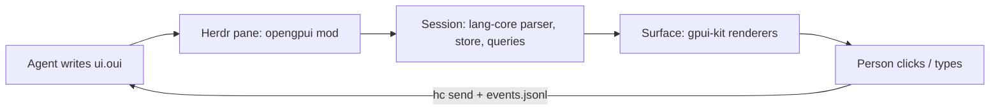

# openGPUI

[OpenUI Lang](https://openui.com) rendered with native [gpui-kit](https://gpui-kit.com)
elements, plus a [Herdr](https://herdr.dev) mod that lets coding agents show
people real UI (forms, tables, cards, approve/reject buttons) and get their
answers back.

OpenUI ships React (and Vue, Svelte, Angular) renderers. openGPUI is the gpui
one: the language, parser, `$state`, queries and actions are OpenUI's own
`@openuidev/lang-core`; the component library (names, zod schemas, prompts) is
OpenUI's own `genui-lib`, compiled without React. Only the drawing is new.



## Layout

| Path | What |
|---|---|
| `src/runtime/` | `Session`: one response's parse, `$state` store, queries/mutations, forms, validation, actions, errors. Framework-free port of react-lang's state hook. |
| `src/render/` | `Surface`: draws a session with gpui-kit; owns the pump task that creates retained native state (inputs, timers) outside `render`. Design tokens. |
| `src/components/` | One renderer per OpenUI component. Missing ones draw a "not supported yet" box and are left out of prompts. |
| `src/library.ts` | OpenUI's `openui` and `chat` libraries, and `subsetLibrary()` to prompt only what is implemented. |
| `herdr/` | The Herdr mod (`herdr/src/main.ts` → `herdr/mods/opengpui/main.js`). |
| `bin/opengpui.ts` | The agent CLI: `prompt`, `check`, `show`, `wait`, `events`. |
| `skills/opengpui/` | Agent skill: how an agent uses the CLI and the pane. |
| `scripts/` | Upstream sync, build (Bun plugin that compiles upstream without React), install. |

## Develop

Needs [Bun](https://bun.sh) and, for the mod, herdr-app.

```sh
bun install
bun run sync           # check out the pinned OpenUI commit (upstream.json); copy gpui/herdr types from Herdr
bun run check          # typecheck, build, herdr-app check on the mod
bun run test           # build, then session/library tests against the built headless bundle
bun run install-herdr  # copy the mod into ~/.config/herdr-app/mods/opengpui, link `opengpui` into ~/.local/bin
```

Outputs (`dist/`):

- `opengpui.js`: the library for gpui-shell hosts (`gpui-kit` and `gpui-base` stay imports).
- `opengpui-headless.js`: libraries, prompts and `Session` without gpui, for Bun/Node.
- `opengpui-cli.js`: the CLI.

### Updating OpenUI

`bun scripts/sync-upstream.ts --to main` moves the pin. The sync fails if the
pinned `lang-core` version differs from the `@openuidev/lang-core` dev
dependency used for types; bump that too, then run `bun run check` and the
tests.

### Adding a component

1. Read its schema in `.upstream/openui/packages/react-ui/src/genui-lib/<Name>/schema.ts`
   and its React renderer next to it for behavior.
2. Write a `Component` in `src/components/` and add it to `src/components/index.ts`.
3. Retained native state (inputs, sliders) goes through `ctx.retained(...)`;
   work that needs a live phase through `ctx.after(...)`.
4. `bun run check`, then look at it in Herdr (`opengpui show`).

## Status

First wave: Stack, Card, CardHeader, TextContent, MarkDownRenderer, Callout,
Text, BoldText, Tag, Separator, Table/Col, Form, FormControl, Label, Input,
TextArea, Button, Buttons. The rest of OpenUI's ~80 components (tabs, selects,
charts, modals, card blocks, …) are not drawn yet. Built against herdr-app
0.1.13 (gpui-shell 0.7.1) and OpenUI lang-core 1.1.0.

## License

MIT. Parts port or compile [OpenUI](https://github.com/thesysdev/openui) (MIT,
Thesys Inc.); see `LICENSE` and `licenses/openui.txt`.
