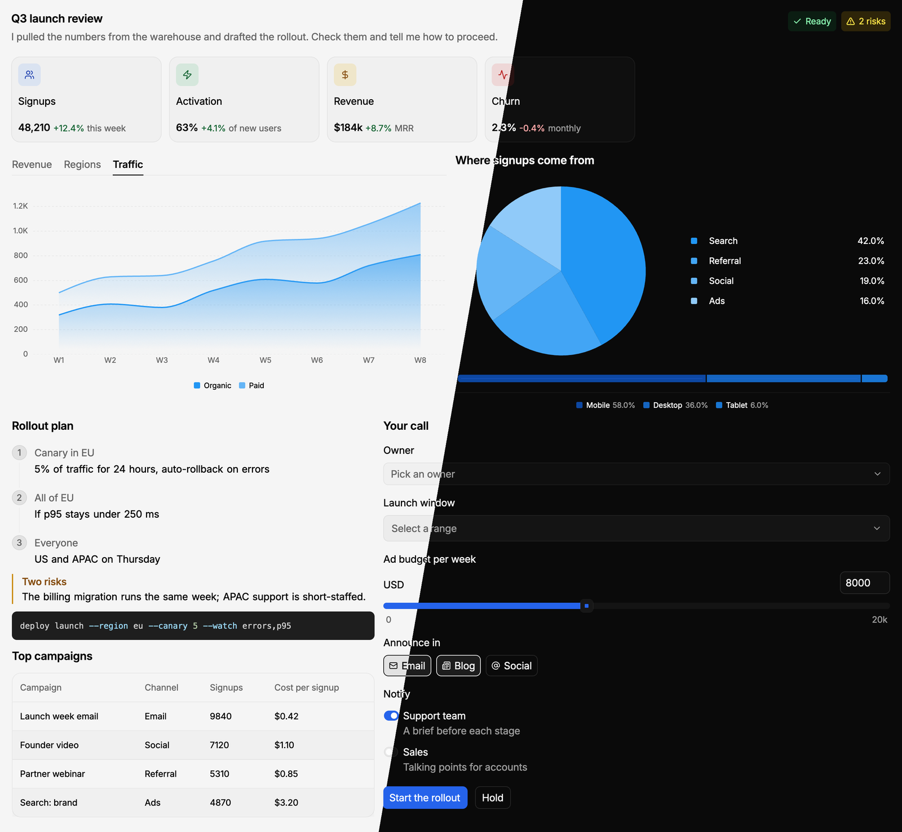

# openGPUI

A pane that shows native UI an agent writes. The agent writes a short OpenUI Lang file (forms,
tables, charts, cards, buttons) and opens it beside its terminal with `opengpui show`. The person
reads it, fills it in and clicks, and each click comes back to the agent as an event, typed into
its terminal or printed by `opengpui wait`. It works with any agent that runs in a Herdr terminal.

## What you see

- A pane (or a tab) beside the agent's terminal, in the Herdr theme's background.
- A 30px header with a bottom border, in OpenUI's small label text and the theme's secondary
  text color: the title (the `--title` the agent gave, else the file name), then, when they
  apply, "streaming…" in the info color, "loading data…", and an error count in the danger
  color.
- The body: the file's UI in an 18px-padded column that scrolls. It is OpenUI's own component
  library (86 components of its `openui` and `chat` libraries): stacks, cards, tabs, accordions,
  steps, carousels, modals; text, markdown and highlighted code; images; tables and an editable
  table; bar, line, area, radar, pie, radial, stacked-bar and scatter charts; forms with inputs,
  text areas, selects, date pickers, sliders, checkboxes, radios, switches, chips and option
  cards; buttons, tags, lists and card blocks. Each draws with OpenUI's sizes, spacing and
  typography in shipped static cuts of Inter, and by default in colors mapped from the Herdr theme
  (`--look openui` uses OpenUI's own light and dark palette).
- When the file has errors: a list under the body (at most 120px, scrolling) in the danger color,
  one line per error.
- Opened without a file: a short page that explains the `opengpui` commands.

## How it behaves

- The pane follows the file: every change the agent writes redraws it, and what the person typed
  stays while field names stay.
- A file framed for streaming (first line `]]>openui:content`, last line `]]>openui:end`)
  redraws as it grows; until the end line arrives the header says "streaming…" and buttons and
  inputs wait.
- A button with `@ToAssistant(...)` (or none) sends an event with its message and the form's
  values. A button inside a Form waits until required fields are valid. `@OpenUrl` opens http(s)
  links in the browser. `$variables`, `@Set` and `@Reset` change the pane without an event.
- Every event is appended to `~/.config/herdr-app/opengpui/events/<file>-<hash>.jsonl` and, unless
  the agent asked for none, sent to the agent's terminal with `hc send` (a headline line, then the
  event as JSON).
- Errors in a complete file are listed in the pane and sent to the agent once, again only when
  they change.
- Hover, focus, Tab and Enter/Space, scrolling, tooltips and the components' own transitions
  behave as OpenUI's React components do, within what gpui can draw.

## Built from

- **Source:** https://github.com/lukachi/openGPUI (MIT). These files are one release build of it;
  the brief is the repository: `bun install && bun run sync && bun run release` rebuilds this
  folder (it needs Bun, uv and a pinned OpenUI checkout that `sync` fetches). A port this size
  can't be rebuilt from a page of prose; build it from the source instead.
- **One mod**, `mods/opengpui/`:
  - `mod.json`: `{ "place": "none", "title": "OpenUI" }`; panes and tabs open it with props.
  - `main.js`: the view, loaded per pane. `shared.js`: the packages it uses (OpenUI's lang-core and
    libraries, zod, unified/remark, refractor, d3, date-fns) and every lucide icon's SVG markup,
    loaded once per Herdr window and kept on `globalThis` under the build's hash. The first time a
    pane draws an icon, it writes that icon's SVG to `~/.config/herdr-app/opengpui/icons/`
    (`svg()` draws only files).
  - `fonts/`: static Inter cuts (and Inter's license). `licenses/`: openGPUI's, OpenUI's,
    lucide's and elkjs's licenses.
  - `cli/opengpui`: the agent's CLI, a launcher that runs `cli/opengpui.mjs` with Node.js 18+ or
    Bun. Commands: `prompt` (the OpenUI Lang manual), `check`, `show`, `wait`, `events`, `close`,
    `skill` (the agent skill), and the internal `layout` the pane runs to lay diagrams out (ELK,
    bundled into `opengpui.mjs` only).
- **Props** (set by `opengpui show` through `pane.split` / `tab.new`): `src` (the file), `reply`
  (terminal to `hc send` events to), `events` (log path), `tools` (Query/Mutation tools file),
  `library`, `components`, `title`, `look`, `cli` (the `opengpui` launcher `show` ran from; the
  pane falls back to `~/.config/herdr-app/mods/opengpui/cli/opengpui`).
- **herdr functions:** `props`, `appHome`, `home`, `readTextFile`, `watchFolder`, `theme`,
  `settings`, `fonts`, `window`, `exec`, `hc`.
- **Programs it runs:** `hc send` (replies); `curl` (remote images, http(s) only, into
  `~/.config/herdr-app/opengpui/images/`, at most 256 MiB); `open` / `xdg-open` (links the person
  clicks); `realpath`, `wc`, `find` (local image checks and cache cleanup); `cli/opengpui layout`
  through Node.js or Bun (each new diagram's layout, cached in
  `~/.config/herdr-app/opengpui/layout/`); and the commands of a tools file the agent passes with
  `--tools`.

## Watch out

- **Tell the person before adding it:** it reaches the network (images by URL, through curl; the
  CLI asks GitHub's API for the latest release at most once a day, off with
  `OPENGPUI_NO_UPDATE_CHECK=1`), runs programs (`hc`, `curl`, the agent's tools commands), reads
  the `.oui` file and local images anywhere under `$HOME`, and writes under
  `~/.config/herdr-app/opengpui/`.
- **Updates:** `opengpui show` and `opengpui --version` say when a newer release is out; the
  skill's "Updating" section replaces this mod's folder with it, once the person agrees.
- **The CLI goes on PATH:** link it, for example
  `ln -s ~/.config/herdr-app/mods/opengpui/cli/opengpui ~/.local/bin/opengpui`. It needs Node.js
  18+ or Bun.
- **The agent needs the skill:** `opengpui skill` prints it; install it where the person's agent
  reads skills, or tell the agent to read it.
- **If the name `opengpui` is taken:** rename the folder; nothing inside refers to it. The CLI opens
  the mod it ships in, by folder name.
- **Fonts:** Herdr loads a mod's fonts at start and on a look change: switch layout once (or
  restart Herdr) after adding it. An updated build with changed cuts needs a restart.
- Files must be under `$HOME` and at most 1 MiB. Tested on macOS with herdr-app 0.1.13.
- Every pane of the mod shares one script engine with all mods; very large pages can hit
  gpui-shell's per-call time budget, and an interrupted part shows gpui's error card in its place.

## Done when

- `herdr-app check mods/opengpui` passes.
- `opengpui --help` lists the commands, and `opengpui skill` prints the skill.
- Write `~/opengpui-test.oui` with
  `root = Stack([CardHeader("Hello"), Buttons([Button("Yes", @ToAssistant("yes"), "primary")])])`;
  `opengpui check ~/opengpui-test.oui` prints `ok:`, `opengpui show ~/opengpui-test.oui --no-reply`
  opens a pane with a "Hello" heading and a Yes button, and after a click on Yes,
  `opengpui wait ~/opengpui-test.oui` prints a `continue_conversation` event with message `yes`.
- `opengpui close ~/opengpui-test.oui` closes the pane.
